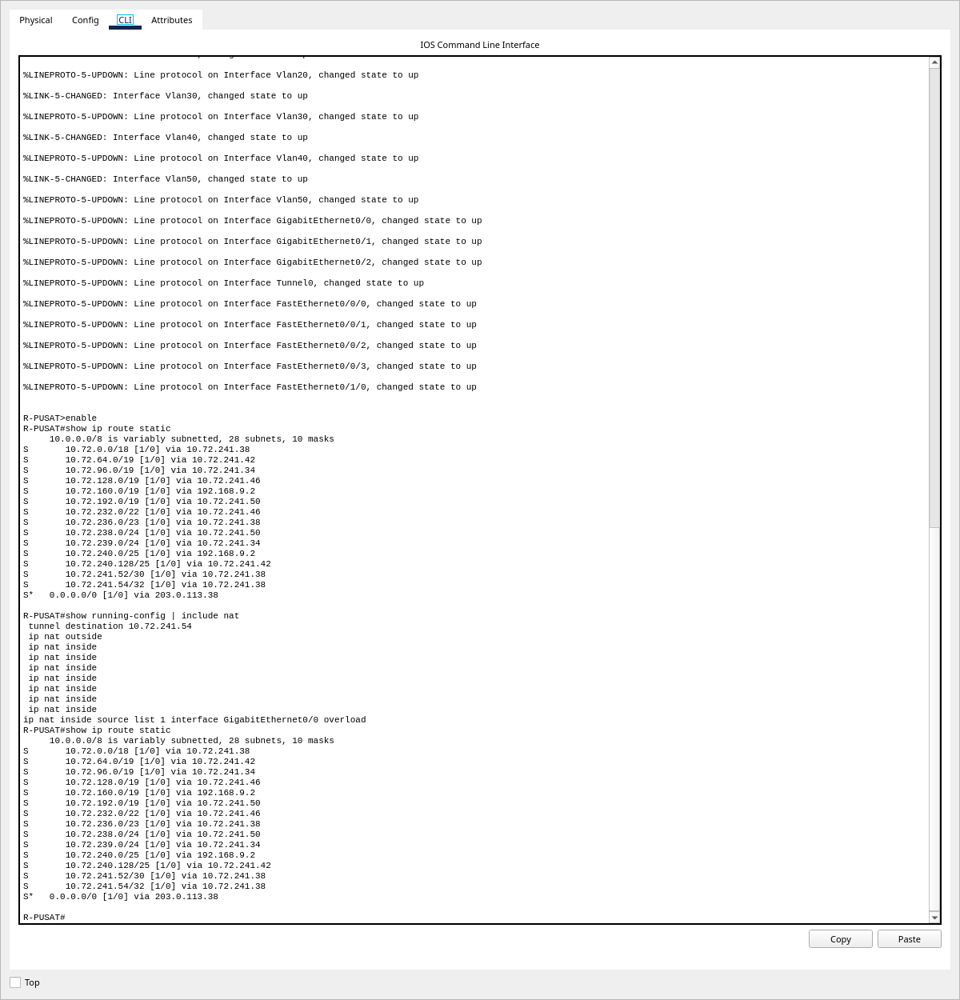
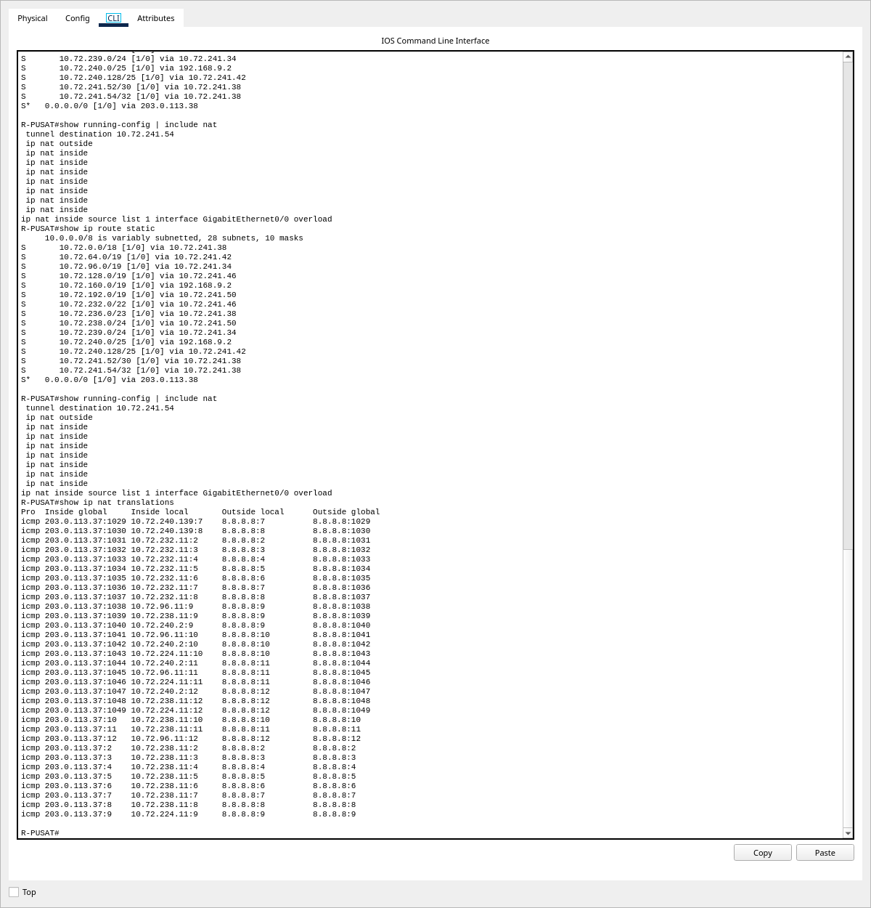

# Anggota A: Subnetting, Static Routing, dan NAT (Kelompok 9, skema VLSM)

Sumber angka: `K9_Subnetting.xlsx` (sheet **VLSM** dan **IP Interface VLSM**).
Blok dasar: `10.72.0.0/16` (oktet ke-2 = 8 × 9 = 72).

## 1. Tabel VLSM (hasil revisi)

| No | Router | Subnet | Host | Network ID/Prefix | Rentang Host | Broadcast | Gateway |
|---|---|---|---|---|---|---|---|
| 1 | R-UTARA | WiFi Publik Utara | 11.000 | 10.72.0.0/18 | 10.72.0.1 – 10.72.63.254 | 10.72.63.255 | 10.72.0.1 |
| 2 | R-SELATAN | WiFi Publik Selatan | 6.500 | 10.72.64.0/19 | 10.72.64.1 – 10.72.95.254 | 10.72.95.255 | 10.72.64.1 |
| 3 | R-DC | CCTV Kota | 6.000 | 10.72.96.0/19 | 10.72.96.1 – 10.72.127.254 | 10.72.127.255 | 10.72.96.1 |
| 4 | R-TIMUR | WiFi Publik Timur | 5.500 | 10.72.128.0/19 | 10.72.128.1 – 10.72.159.254 | 10.72.159.255 | 10.72.128.1 |
| 5 | R-PELABUHAN | Sensor dan SCADA Pelabuhan | 5.000 | 10.72.160.0/19 | 10.72.160.1 – 10.72.191.254 | 10.72.191.255 | 10.72.160.1 |
| 6 | R-BARAT | WiFi Publik Barat | 4.500 | 10.72.192.0/19 | 10.72.192.1 – 10.72.223.254 | 10.72.223.255 | 10.72.192.1 |
| 7 | R-PUSAT | Pegawai Balai Kota | 1.800 | 10.72.224.0/21 | 10.72.224.1 – 10.72.231.254 | 10.72.231.255 | 10.72.224.1 |
| 8 | R-TIMUR | Sensor Banjir Timur | 700 | 10.72.232.0/22 | 10.72.232.1 – 10.72.235.254 | 10.72.235.255 | 10.72.232.1 |
| 9 | R-UTARA | Sensor Lalu Lintas Utara | 450 | 10.72.236.0/23 | 10.72.236.1 – 10.72.237.254 | 10.72.237.255 | 10.72.236.1 |
| 10 | R-BARAT | Puskesmas dan Sekolah Barat | 220 | 10.72.238.0/24 | 10.72.238.1 – 10.72.238.254 | 10.72.238.255 | 10.72.238.1 |
| 11 | R-DC | Server dan Storage DC | 180 | 10.72.239.0/24 | 10.72.239.1 – 10.72.239.254 | 10.72.239.255 | 10.72.239.1 |
| 12 | R-PELABUHAN | Kantor Pelabuhan | 120 | 10.72.240.0/25 | 10.72.240.1 – 10.72.240.126 | 10.72.240.127 | 10.72.240.1 |
| 13 | R-SELATAN | PJU Pintar Selatan | 90 | 10.72.240.128/25 | 10.72.240.129 – 10.72.240.254 | 10.72.240.255 | 10.72.240.129 |
| 14 | R-PUSAT | Server Balai Kota | 20 | 10.72.241.0/27 | 10.72.241.1 – 10.72.241.30 | 10.72.241.31 | 10.72.241.1 |
| 15 | PUSAT–DC | L1 | 2 | 10.72.241.32/30 | .33 (PUSAT) – .34 (DC) | 10.72.241.35 | – |
| 16 | PUSAT–UTARA | L2 | 2 | 10.72.241.36/30 | .37 (PUSAT) – .38 (UTARA) | 10.72.241.39 | – |
| 17 | PUSAT–SELATAN | L3 | 2 | 10.72.241.40/30 | .41 (PUSAT) – .42 (SELATAN) | 10.72.241.43 | – |
| 18 | PUSAT–TIMUR | L4 | 2 | 10.72.241.44/30 | .45 (PUSAT) – .46 (TIMUR) | 10.72.241.47 | – |
| 19 | PUSAT–BARAT | L5 | 2 | 10.72.241.48/30 | .49 (PUSAT) – .50 (BARAT) | 10.72.241.51 | – |
| 20 | UTARA–PELABUHAN | L6 | 2 | 10.72.241.52/30 | .53 (UTARA) – .54 (PELABUHAN) | 10.72.241.55 | – |

Kebutuhan host: 42.092 / 65.536 = **64,23%** dari blok induk `/16`.
Blok subnet yang dialokasikan berjumlah **61.752 alamat (94,23%)**, termasuk network dan broadcast.
Sisa sebelum L7 adalah 3.784 alamat. Alamat kosong pertama `10.72.241.56` digunakan untuk L7 OSPF: `10.72.241.56/30`.

Tambahan Mid-Project: R-PUSAT–R-ISP `203.0.113.36/30` (PUSAT `.37`, ISP `.38`),
server `8.8.8.8/24` (gateway `8.8.8.1`), GRE utama `192.168.9.0/30`.
File OSPF menambah GRE cadangan `192.168.9.4/30`, sesuai keputusan kelompok.

### Perbandingan CIDR dan revisi UTS

VLSM dipilih untuk implementasi karena alokasi berurutan cukup ditampung `10.72.0.0/16`.
Pohon CIDR pada workbook memakai `10.72.0.0/14`: penggabungan blok dilakukan per router,
lalu per cabang. Pemakaian berdasarkan kebutuhan host pada blok CIDR adalah **16,06%**.
Alamat implementasi mengikuti sheet VLSM; sheet CIDR menjadi hasil perhitungan pembanding.

Workbook memuat 20 alokasi VLSM, 20 alokasi CIDR, 12 simpul supernet, dan 12 baris revisi.
Perbaikan meliputi host pertama, batas host/broadcast, alignment link `/30`, LAN lokal PUSAT,
serta penempatan L6 pada pohon CIDR. Foto sumber tersedia di [UTS Tulis](UTS%20Tulis/).

- [Tabel kebutuhan host](screenshots/subnetting-kebutuhan.png)
- [Tabel VLSM](screenshots/subnetting-vlsm.png)
- [Tabel CIDR](screenshots/subnetting-cidr.png)
- [Pohon supernet CIDR](screenshots/subnetting-supernet-cidr.png)
- [Revisi jawaban UTS](screenshots/subnetting-revisi.png)
- [IP interface](screenshots/subnetting-interface.png)

## 2. Static Routing (Soal 3)

Prinsip:
- Semua default route mengarah ke upstream. R-PELABUHAN juga mempunyai dua route LAN melalui GRE dan route endpoint fisik.
- R-UTARA: default route ke R-PUSAT + static route ke LAN R-PELABUHAN.
- R-PUSAT: default route ke R-ISP + static route ke **semua LAN** di bawahnya.
- Konfigurasi berikut sesuai file final static, termasuk route GRE. Pemetaan port ada di [K9_PT_Config.md](K9_PT_Config.md).

### R-PUSAT
```
! Default route keluar ke internet
ip route 0.0.0.0 0.0.0.0 203.0.113.38
! R-DC (via L1)
ip route 10.72.96.0 255.255.224.0 10.72.241.34
ip route 10.72.239.0 255.255.255.0 10.72.241.34
! R-UTARA (via L2)
ip route 10.72.0.0 255.255.192.0 10.72.241.38
ip route 10.72.236.0 255.255.254.0 10.72.241.38
! LAN Pelabuhan lewat GRE; endpoint GRE tetap lewat jaringan fisik
ip route 10.72.160.0 255.255.224.0 192.168.9.2
ip route 10.72.240.0 255.255.255.128 192.168.9.2
ip route 10.72.241.52 255.255.255.252 10.72.241.38
ip route 10.72.241.54 255.255.255.255 10.72.241.38
! R-SELATAN (via L3)
ip route 10.72.64.0 255.255.224.0 10.72.241.42
ip route 10.72.240.128 255.255.255.128 10.72.241.42
! R-TIMUR (via L4)
ip route 10.72.128.0 255.255.224.0 10.72.241.46
ip route 10.72.232.0 255.255.252.0 10.72.241.46
! R-BARAT (via L5)
ip route 10.72.192.0 255.255.224.0 10.72.241.50
ip route 10.72.238.0 255.255.255.0 10.72.241.50
```

### R-UTARA
```
ip route 0.0.0.0 0.0.0.0 10.72.241.37
ip route 10.72.160.0 255.255.224.0 10.72.241.54
ip route 10.72.240.0 255.255.255.128 10.72.241.54
```

### R-DC
```
ip route 0.0.0.0 0.0.0.0 10.72.241.33
```

### R-SELATAN
```
ip route 0.0.0.0 0.0.0.0 10.72.241.41
```

### R-TIMUR
```
ip route 0.0.0.0 0.0.0.0 10.72.241.45
```

### R-BARAT
```
ip route 0.0.0.0 0.0.0.0 10.72.241.49
```

### R-PELABUHAN
```
ip route 0.0.0.0 0.0.0.0 10.72.241.53
ip route 10.72.241.37 255.255.255.255 10.72.241.53
ip route 10.72.224.0 255.255.248.0 192.168.9.1
ip route 10.72.241.0 255.255.255.224 192.168.9.1
```

### R-ISP
Tidak ada `ip route` sama sekali. Kedua jaringannya (`203.0.113.36/30` dan `8.8.8.0/24`) terhubung langsung, dan R-ISP **tidak boleh** tahu rute ke `10.72.0.0`.

## 3. NAT Overload (Soal 5)

NAT berada di R-PUSAT. Port FastEthernet HWIC-4ESW menggunakan SVI sebagai interface Layer 3.

```
! ACL: seluruh alamat privat internal kelompok 9
access-list 1 permit 10.72.0.0 0.0.255.255

! Interface ke R-ISP
interface GigabitEthernet0/0
 ip address 203.0.113.37 255.255.255.252
 ip nat outside
 no shutdown

! Semua interface ke arah dalam: L1, L2, L3, L4, L5, LAN Pegawai, LAN Server Balai Kota
interface GigabitEthernet0/1
 ip nat inside
interface GigabitEthernet0/2
 ip nat inside
interface Vlan10
 ip nat inside
interface Vlan20
 ip nat inside
interface Vlan30
 ip nat inside
interface Vlan50
 ip nat inside
interface Vlan40
 ip nat inside
exit

! PAT: semua host keluar memakai IP publik 203.0.113.37
ip nat inside source list 1 interface GigabitEthernet0/0 overload
```

R-ISP (hanya IP, tanpa route):
```
interface GigabitEthernet0/0
 ip address 203.0.113.38 255.255.255.252
 no shutdown
interface GigabitEthernet0/1
 ip address 8.8.8.1 255.255.255.0
 no shutdown
```
Server 8.8.8.8: IP `8.8.8.8`, mask `255.255.255.0`, gateway `8.8.8.1`.

## 4. Verifikasi dan screenshot

| Cek | Perintah | Hasil pada pengujian native |
|---|---|---|
| Tabel routing R-PUSAT | `show ip route static` | 12 route LAN, route L6 `/30`, endpoint `/32`, default ISP: total 15 |
| Tabel routing R-UTARA | `show ip route static` | `S*` via .37 + 2 route ke LAN Pelabuhan via .54 |
| R-ISP bersih | `show ip route` di R-ISP | Hanya `C`/`L` untuk 203.0.113.36/30 dan 8.8.8.0/24, **tanpa 10.x** |
| Antar-LAN | Semua pasangan 15 endpoint internal | 210 arah mencapai 4/4 setelah warm-up |
| Internet | `ping 8.8.8.8` dari 15 endpoint internal | 15/15 mencapai 4/4 melalui NAT |
| Translasi NAT | `show ip nat translations` di R-PUSAT (setelah ping) | Inside global `203.0.113.37`, inside local `10.72.x.x` |
| Konfigurasi NAT | `show running-config \| include nat` | Baris `ip nat inside/outside` dan `overload` |





Bukti konfigurasi: [R-UTARA](screenshots/static-routes-utara.png),
[R-ISP](screenshots/static-routes-isp.png), [NAT](screenshots/static-nat-config.png).

| Wilayah | Host sumber | Bukti internet 4/4 |
|---|---|---|
| Pusat | PC - PEGAWAI | [Screenshot](screenshots/static-internet-pusat.png) |
| DC | CCTV KOTA | [Screenshot](screenshots/static-internet-dc.png) |
| Utara | SENSOR LANTAS UTARA | [Screenshot](screenshots/static-internet-utara.png) |
| Pelabuhan | PC KANTOR | [Screenshot](screenshots/static-internet-pelabuhan.png) |
| Selatan | PJU SELATAN | [Screenshot](screenshots/static-internet-selatan.png) |
| Timur | SENSOR BANJIR | [Screenshot](screenshots/static-internet-timur.png) |
| Barat | PUSKESMAS | [Screenshot](screenshots/static-internet-barat.png) |

Log lengkap beserta retry saat warm-up: [mesh static](evidence/static-mesh.json),
[internet static](evidence/static-internet.json), [mesh OSPF](evidence/ospf-mesh.json),
dan [internet OSPF](evidence/ospf-internet.json).

## 5. Catatan untuk anggota lain

- **DHCP**: Kantor Pelabuhan mengecualikan hanya `.1`, sehingga tersisa 125 lease untuk 120 klien.
  CCTV memiliki 6.000 lease pada SERVER DC; gateway dan IP server berada di luar rentang lease.
- **GRE static**: konfigurasi endpoint dan LAN di atas memerlukan Tunnel0 aktif;
  lihat [GRE dan IPsec](AnggotaC_GRE_OSPF_Layanan.md).
- **OSPF**: L7 memakai `10.72.241.56/30`. Semua static antar-router dihapus pada salinan OSPF;
  hanya default ISP di R-PUSAT yang tetap static.
