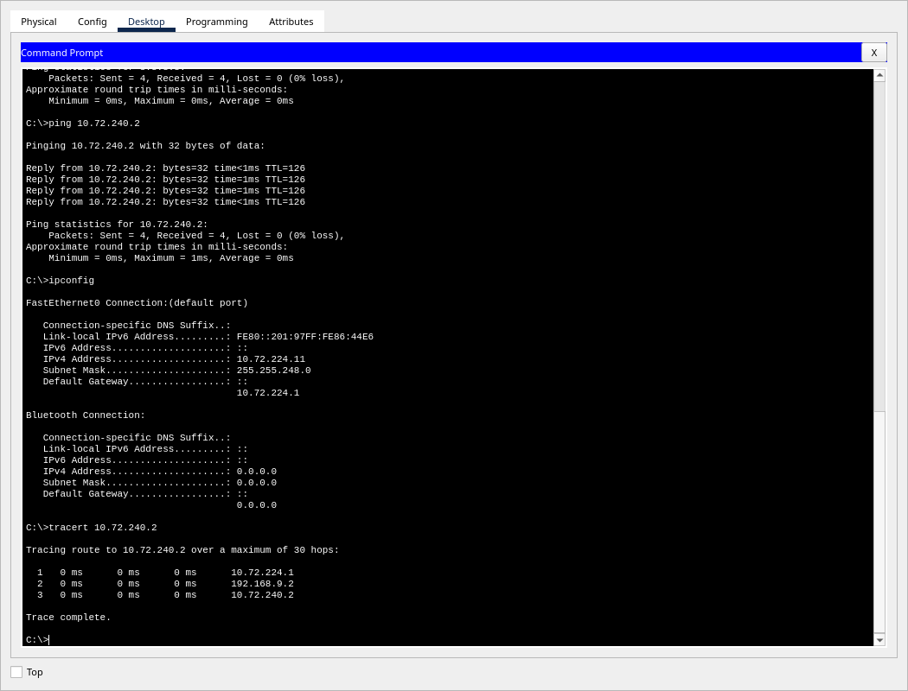
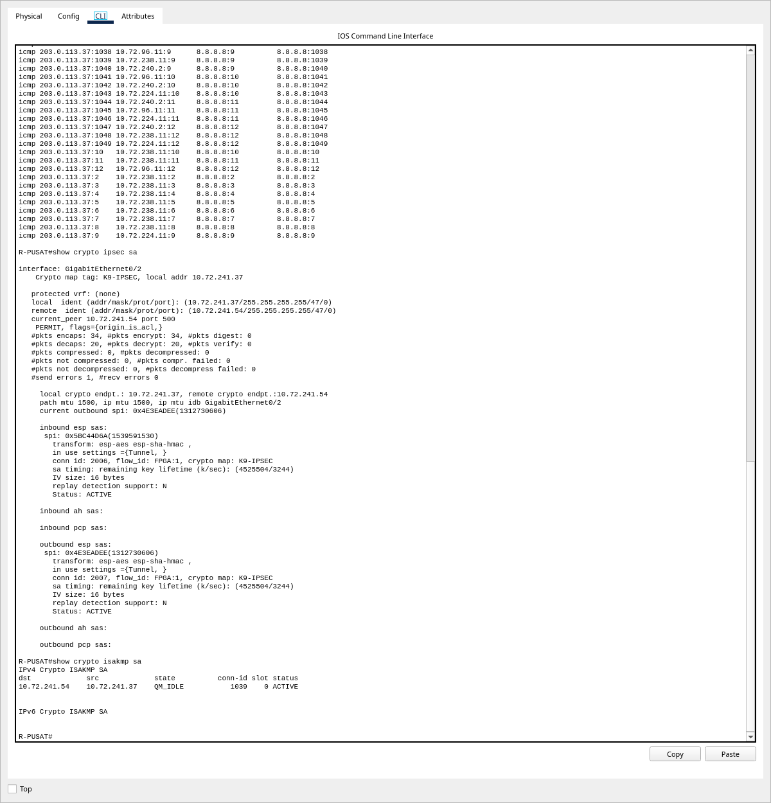
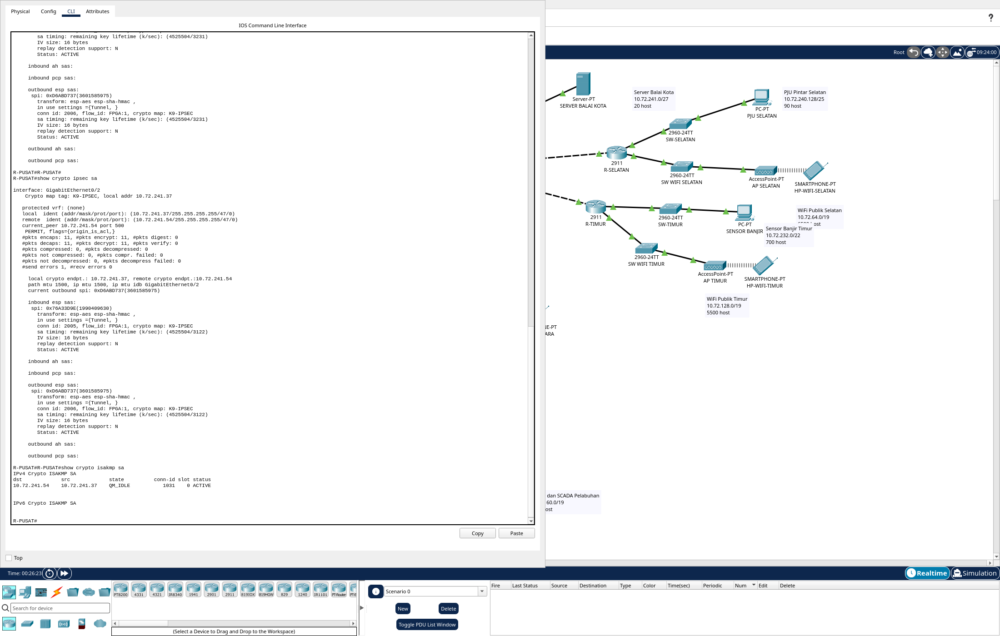
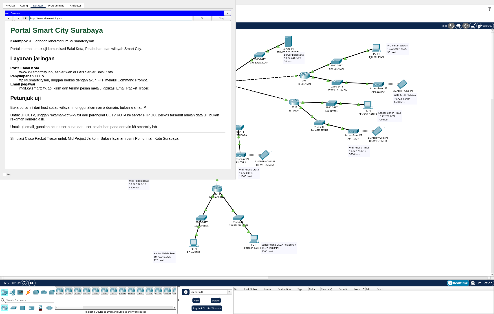
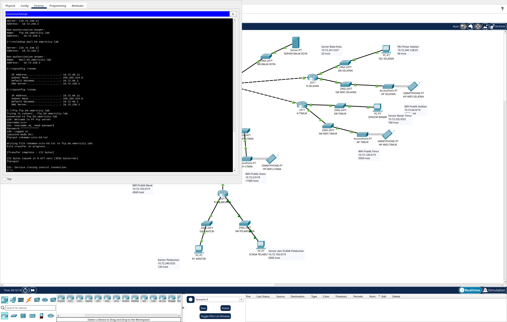
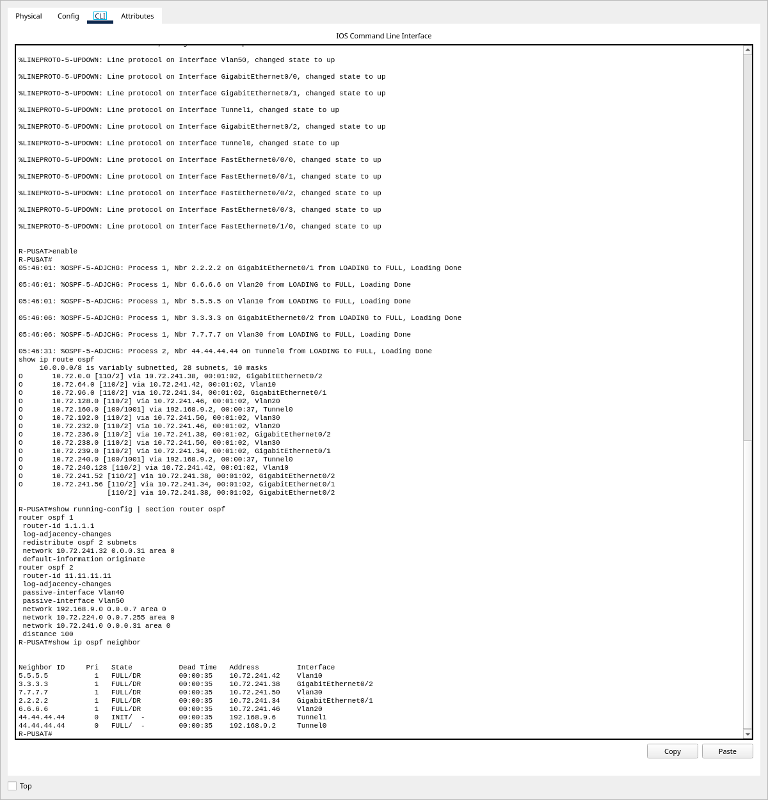
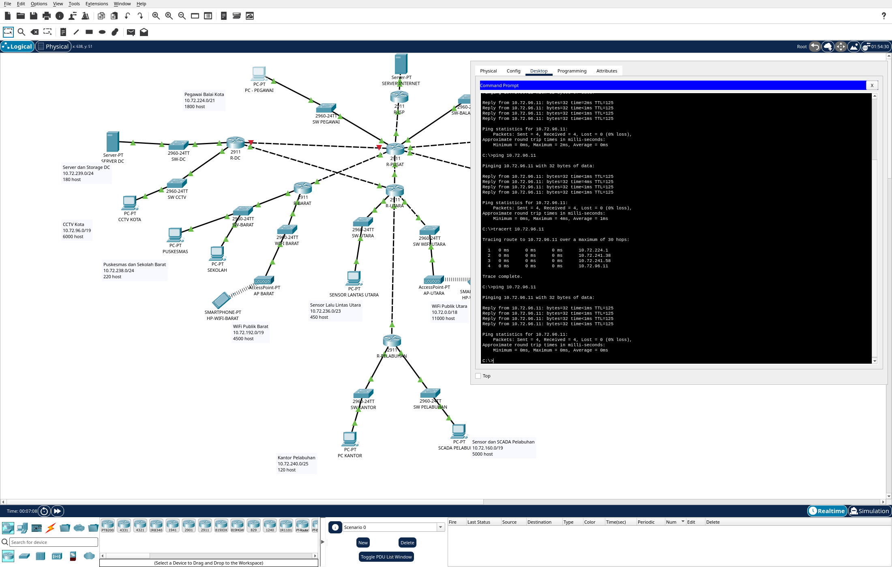
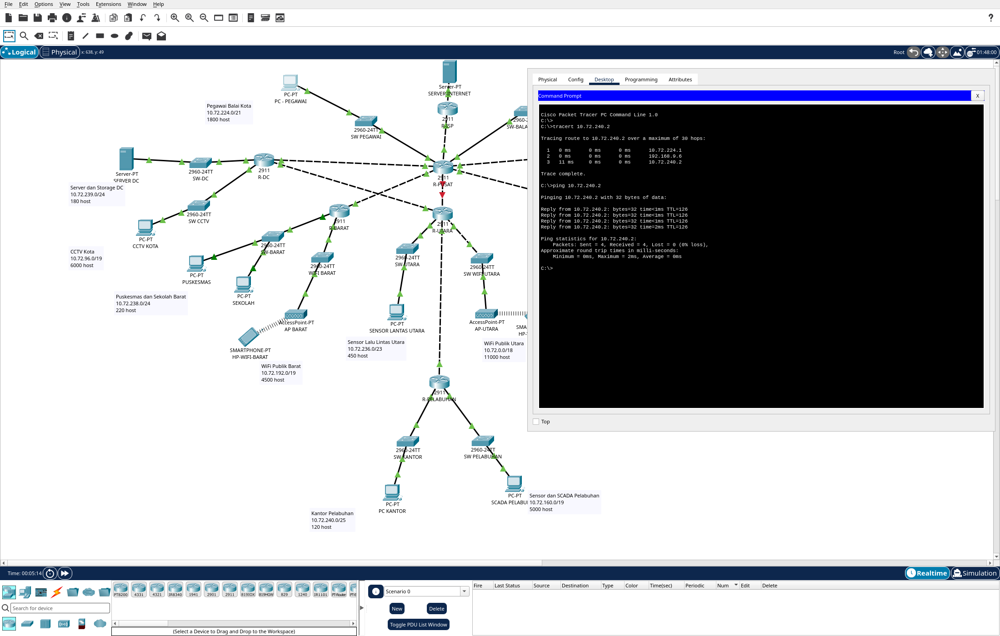

# Anggota C: GRE, IPsec, OSPF, dan Layanan Aplikasi (Kelompok 9, VLSM)

Konfigurasi dan bukti di bawah berasal dari pengujian native Cisco Packet Tracer **9.0.1.0858**.

| File | Routing dan tunnel | Layanan |
|---|---|---|
| `K9_VLSM.pkt` | Static, Tunnel0 GRE dengan bonus IPsec | NAT, DHCP, DNS, Web, FTP, Email |
| `K9_VLSM_OSPF.pkt` | OSPF, L7, Tunnel0 dan Tunnel1 GRE tanpa IPsec | NAT, DHCP, DNS, Web, FTP, Email |

GRE utama memakai `192.168.9.0/30`. GRE cadangan `192.168.9.4/30` hanya ada pada file OSPF,
sesuai keputusan kelompok. Pemetaan port lengkap tersedia di [K9_PT_Config.md](K9_PT_Config.md).

## 1. GRE dan bonus IPsec pada file static (Soal 6)

### 1.1. Tunnel0 dan route LAN

R-PUSAT:

```text
configure terminal
interface Tunnel0
 ip address 192.168.9.1 255.255.255.252
 tunnel source GigabitEthernet0/2
 tunnel destination 10.72.241.54
 no shutdown
exit
ip route 10.72.241.54 255.255.255.255 10.72.241.38
ip route 10.72.160.0 255.255.224.0 192.168.9.2
ip route 10.72.240.0 255.255.255.128 192.168.9.2
end
```

R-PELABUHAN:

```text
configure terminal
interface Tunnel0
 ip address 192.168.9.2 255.255.255.252
 tunnel source GigabitEthernet0/0
 tunnel destination 10.72.241.37
 no shutdown
exit
ip route 10.72.241.37 255.255.255.255 10.72.241.53
ip route 10.72.224.0 255.255.248.0 192.168.9.1
ip route 10.72.241.0 255.255.255.224 192.168.9.1
end
```

Route `/32` menjaga endpoint GRE tetap dijangkau melalui jaringan fisik.
Default route dan route LAN lain mengikuti [laporan Anggota A](AnggotaA_Routing_NAT.md).

### 1.2. Konfigurasi IPsec yang teruji

Crypto map dipasang pada interface fisik pembawa GRE. ACL 110 memilih protokol GRE (IP protocol 47)
antara `10.72.241.37` dan `10.72.241.54`.

R-PUSAT:

```text
configure terminal
crypto isakmp policy 10
 encr aes
 authentication pre-share
 group 5
exit
crypto isakmp key K9-GRE-IPsec-Lab! address 10.72.241.54
crypto ipsec transform-set K9-GRE esp-aes esp-sha-hmac
crypto map K9-IPSEC 10 ipsec-isakmp
 set peer 10.72.241.54
 set transform-set K9-GRE
 match address 110
exit
access-list 110 permit gre host 10.72.241.37 host 10.72.241.54
interface GigabitEthernet0/2
 crypto map K9-IPSEC
end
```

R-PELABUHAN:

```text
configure terminal
crypto isakmp policy 10
 encr aes
 authentication pre-share
 group 5
exit
crypto isakmp key K9-GRE-IPsec-Lab! address 10.72.241.37
crypto ipsec transform-set K9-GRE esp-aes esp-sha-hmac
crypto map K9-IPSEC 10 ipsec-isakmp
 set peer 10.72.241.37
 set transform-set K9-GRE
 match address 110
exit
access-list 110 permit gre host 10.72.241.54 host 10.72.241.37
interface GigabitEthernet0/0
 crypto map K9-IPSEC
end
```

Mode IPsec yang terverifikasi adalah **tunnel**, sesuai output `in use settings ={Tunnel, }`.
Pada Packet Tracer versi ini, perintah `crypto ipsec transform-set` tetap berada di mode konfigurasi global.
Karena itu, perintah berikutnya langsung `crypto map`; menyisipkan `exit` di antaranya akan keluar dari mode konfigurasi.

### 1.3. Hasil traceroute dan enkripsi

Traceroute PC - PEGAWAI (`10.72.224.11`) ke PC KANTOR (`10.72.240.2`):

```text
1  10.72.224.1
2  192.168.9.2
3  10.72.240.2
```

Arah balik melalui `10.72.240.1 → 192.168.9.1 → 10.72.224.11`.
Paket GRE tetap dibawa oleh link fisik L2 dan L6; router transit tersembunyi dari traceroute paket di dalam tunnel.



[Traceroute arah balik](screenshots/static-gre-pelabuhan.png) dan
[log kedua arah](evidence/static-gre-traces.json).

Setelah traffic uji, kedua peer mencapai `QM_IDLE` dan SA IPsec `ACTIVE`.
Perbandingan counter berikut membuktikan ada traffic terenkripsi selama pengujian:

| Router | Encrypt sebelum → sesudah | Decrypt sebelum → sesudah |
|---|---|---|
| R-PUSAT | 230 → 238 | 54 → 62 |
| R-PELABUHAN | 54 → 62 | 230 → 238 |



Log: [sebelum](evidence/static-crypto-before.json), [traffic](evidence/static-crypto-traffic.json),
[sesudah](evidence/static-crypto-after.json).

### 1.4. Alasan pemilihan tunnel

Pada file static, route spesifik LAN Pelabuhan di R-PUSAT menggunakan next-hop `192.168.9.2`.
Route dua LAN Balai Kota di R-PELABUHAN menggunakan `192.168.9.1`.
Prefix LAN tersebut lebih spesifik daripada default route, sehingga lookup tujuan memilih tunnel.
File final tidak memiliki route fisik pesaing dengan prefix LAN yang sama di kedua endpoint.

GRE membungkus paket dengan header GRE dan IP luar. GRE sendiri tidak menyediakan enkripsi,
autentikasi peer, atau integritas kriptografis. IPsec ESP dengan `esp-aes esp-sha-hmac`
menambahkan enkripsi AES serta integritas/autentikasi HMAC pada traffic GRE yang dipilih ACL.
Pada file OSPF, GRE berjalan tanpa perlindungan IPsec; pemilihan route dijelaskan pada bagian 3.

### 1.5. Pemulihan IPsec setelah power-cycle Packet Tracer

Pada dua percobaan power-cycle perangkat, konfigurasi crypto hilang dari running-config meskipun masih ada
di startup-config. `copy startup-config running-config` saja tidak memulihkannya pada simulator ini.
Tunnel GRE dapat tetap up dan ping berhasil tanpa enkripsi, sehingga ping saja bukan bukti pemulihan IPsec.

Prosedur yang berhasil diuji:

1. Di kedua endpoint, masuk privileged EXEC dengan `enable`. Periksa `show running-config`
   dan `show startup-config`, terutama policy, key, transform-set, crypto map, ACL, dan binding interface.
2. Terapkan ulang seluruh blok IPsec bagian **1.2** pada masing-masing router.
3. Dari PC - PEGAWAI jalankan `ping 10.72.240.2`; dari PC KANTOR jalankan `ping 10.72.224.11`.
   Tunggu ARP/IKE selesai, kemudian ulangi sampai 4/4. Percobaan awal dapat mengalami timeout.
4. Jalankan `show crypto isakmp sa` dan `show crypto ipsec sa` di kedua router.
   Pastikan `QM_IDLE`, SA `ACTIVE`, serta counter encrypt/decrypt bertambah setelah ping tambahan.
5. Jalankan `write memory` pada kedua router, kemudian simpan file `.pkt`.

Log [sebelum pemulihan](evidence/static-recovery-repeat-before.json) memperlihatkan perbedaan running/startup.
Log [uji startup-copy](evidence/static-recovery-copy-check.json) memperlihatkan crypto belum kembali.
Tersedia [perintah reapply](evidence/static-recovery-repeat-reapply.json),
[hasil SA](evidence/static-recovery-repeat-after.json),
[retry ping](evidence/static-recovery-repeat-pings.json), dan
[ping stabil](evidence/static-recovery-stable.json).
Kenaikan counter pemulihan ada pada [sebelum](evidence/static-recovery-crypto-before.json)
dan [sesudah](evidence/static-recovery-crypto-after.json).



Pembukaan ulang file final juga diuji tanpa modul scripting: GRE dan internet mencapai 4/4,
traceroute melalui GRE, dan [ISAKMP mencapai QM_IDLE](screenshots/static-final-gui-isakmp.png).
Bedakan warm-up saat membuka file dari hilangnya konfigurasi setelah power-cycle.

## 2. Layanan aplikasi Smart City (Soal 8)

DNS, FTP, Email, dan DHCP CCTV berada di SERVER DC (`10.72.239.2/24`).
Web berada di SERVER BALAI KOTA (`10.72.241.2/27`). Domain internal: `k9.smartcity.lab`.

| A record DNS | Alamat |
|---|---|
| `k9.smartcity.lab` | `10.72.241.2` |
| `www.k9.smartcity.lab` | `10.72.241.2` |
| `ftp.k9.smartcity.lab` | `10.72.239.2` |
| `mail.k9.smartcity.lab` | `10.72.239.2` |

HTTP dan HTTPS aktif pada web server. HTTP melalui `http://www.k9.smartcity.lab` diuji dari 15 endpoint
pada setiap file; seluruh body cocok dengan [portal/index.html](portal/index.html), berukuran 1.492 byte.
Tiga nama `www`, `ftp`, dan `mail` diuji memakai `nslookup` dari 15 endpoint: 45 lookup benar per file.

| Layanan/klien | User | Password lab | Pengaturan |
|---|---|---|---|
| FTP | `cctv` | `K9-CCTV-Lab!` | Izin RWDNL, termasuk upload |
| Email PC - PEGAWAI | `user-pusat` | `K9-Pusat-Lab!` | `user-pusat@k9.smartcity.lab` |
| Email PC KANTOR | `user-pelabuhan` | `K9-Pelabuhan-Lab!` | `user-pelabuhan@k9.smartcity.lab` |

SMTP dan POP3 aktif dengan domain `k9.smartcity.lab`. Kedua klien memakai
`mail.k9.smartcity.lab` sebagai incoming/outgoing server. FTP hanya diaktifkan pada SERVER DC.

Uji upload dari CCTV KOTA:

```text
ftp ftp.k9.smartcity.lab
```

Masukkan user/password FTP, lalu jalankan:

```text
put rekaman-cctv-k9.txt
quit
```

Kedua file menghasilkan `Transfer complete - 272 bytes`, sesuai
[berkas contoh rekaman](samples/rekaman-cctv-k9.txt).
Email dua arah dibuktikan dengan pesan diterima di aplikasi Email masing-masing PC.

| Bukti layanan | Static | OSPF |
|---|---|---|
| Web di browser | [Screenshot](screenshots/static-web.png) | [Screenshot](screenshots/ospf-web-final.png) |
| Body HTTP dari 15 endpoint | [Log](evidence/static-http.json) | [Log](evidence/ospf-http.json) |
| FTP upload | [Log](evidence/static-ftp.json) | [Log](evidence/ospf-ftp.json) |
| Email diterima Pelabuhan | [Screenshot](screenshots/static-email-kantor.png) | [Screenshot](screenshots/ospf-email-kantor-final.png) |
| Email diterima Pusat | [Screenshot](screenshots/static-email-pegawai.png) | [Screenshot](screenshots/ospf-email-pegawai-final.png) |
| Isi mailbox | [Log](evidence/static-email.json) | [Log](evidence/ospf-email-final.json) |





[Konfigurasi DNS](screenshots/ospf-dns-server.png) dan [akun FTP](screenshots/ospf-ftp-server.png).
Indeks log DNS tersedia di [evidence/README.md](evidence/README.md).

## 3. OSPF dan link cadangan L7 (Soal 7)

### 3.1. Migrasi pada salinan terpisah

Implementasi berada di `K9_VLSM_OSPF.pkt`. Semua static antar-router, termasuk route LAN melalui GRE
dan route endpoint `/32`, dihapus dari salinan ini. Satu-satunya static route adalah default ISP di R-PUSAT:

```text
ip route 0.0.0.0 0.0.0.0 203.0.113.38
```

R-ISP tidak mengikuti OSPF dan hanya mengenal jaringan connected publik serta server internet.
NAT tetap di R-PUSAT. IPsec dilepas dari salinan OSPF sesuai keputusan kelompok.

L7 memakai modul HWIC-4ESW pada R-DC dan kabel crossover
`R-DC Fa0/0/0 ↔ R-UTARA Fa0/3/1`, dengan IP pada SVI Vlan1.

R-DC:

```text
configure terminal
interface FastEthernet0/0/0
 switchport mode access
 switchport access vlan 1
 no shutdown
interface Vlan1
 ip address 10.72.241.58 255.255.255.252
 no shutdown
end
```

R-UTARA:

```text
configure terminal
interface FastEthernet0/3/1
 switchport mode access
 switchport access vlan 1
 no shutdown
interface Vlan1
 ip address 10.72.241.57 255.255.255.252
 no shutdown
end
```

### 3.2. GRE cadangan

Tunnel0 memakai parameter yang sama dengan bagian 1.1, tanpa static route dan crypto.
Tunnel1 memakai alamat sumber PUSAT pada L1, sehingga tetap bisa digunakan ketika interface L2 mati.

| Tunnel | PUSAT IP tunnel / sumber fisik | PELABUHAN IP tunnel / sumber fisik |
|---|---|---|
| Tunnel0 | `192.168.9.1/30` / `10.72.241.37` (Gi0/2) | `192.168.9.2/30` / `10.72.241.54` (Gi0/0) |
| Tunnel1 | `192.168.9.5/30` / `10.72.241.33` (Gi0/1) | `192.168.9.6/30` / `10.72.241.54` (Gi0/0) |

R-PUSAT:

```text
configure terminal
interface Tunnel1
 ip address 192.168.9.5 255.255.255.252
 tunnel source GigabitEthernet0/1
 tunnel destination 10.72.241.54
 no shutdown
end
```

R-PELABUHAN:

```text
configure terminal
interface Tunnel1
 ip address 192.168.9.6 255.255.255.252
 tunnel source GigabitEthernet0/0
 tunnel destination 10.72.241.33
 no shutdown
end
```

### 3.3. Pemisahan OSPF fisik dan GRE

OSPF proses 1 menangani jaringan fisik (*underlay*). Pada PUSAT dan PELABUHAN,
OSPF proses 2 menangani GRE serta LAN endpoint (*overlay*), dengan administrative distance **100**.
Rute proses 2 disebarkan ke proses 1 lewat `redistribute ospf 2 subnets` agar router wilayah lain
dapat menjangkau LAN endpoint. Proses 2 tidak mengimpor underlay.

Pemisahan ini menjaga alamat tujuan GRE dicapai melalui link fisik, mencegah lookup endpoint
berputar kembali ke tunnel. Untuk prefix LAN yang sama, AD 100 membuat route GRE mengalahkan
route proses 1 dengan AD 110. Route LAN tetap dinamis dan dapat pindah tunnel saat link gagal.

R-PUSAT:

```text
configure terminal
router ospf 1
 router-id 1.1.1.1
 log-adjacency-changes
 redistribute ospf 2 subnets
 network 10.72.241.32 0.0.0.31 area 0
 default-information originate
router ospf 2
 router-id 11.11.11.11
 log-adjacency-changes
 passive-interface Vlan40
 passive-interface Vlan50
 network 192.168.9.0 0.0.0.7 area 0
 network 10.72.224.0 0.0.7.255 area 0
 network 10.72.241.0 0.0.0.31 area 0
 distance 100
end
```

R-PELABUHAN:

```text
configure terminal
router ospf 1
 router-id 4.4.4.4
 log-adjacency-changes
 redistribute ospf 2 subnets
 network 10.72.241.52 0.0.0.3 area 0
router ospf 2
 router-id 44.44.44.44
 log-adjacency-changes
 passive-interface GigabitEthernet0/1
 passive-interface GigabitEthernet0/2
 network 192.168.9.0 0.0.0.7 area 0
 network 10.72.160.0 0.0.31.255 area 0
 network 10.72.240.0 0.0.0.127 area 0
 distance 100
end
```

Lima router lain hanya memakai `router ospf 1`, `log-adjacency-changes`, dan
`network 10.72.0.0 0.0.255.255 area 0`, dengan parameter berikut:

| Router | Router ID | Passive-interface LAN |
|---|---|---|
| R-DC | `2.2.2.2` | `GigabitEthernet0/1`, `GigabitEthernet0/2` |
| R-UTARA | `3.3.3.3` | `GigabitEthernet0/2`, `Vlan60` |
| R-SELATAN | `5.5.5.5` | `GigabitEthernet0/1`, `GigabitEthernet0/2` |
| R-TIMUR | `6.6.6.6` | `GigabitEthernet0/1`, `GigabitEthernet0/2` |
| R-BARAT | `7.7.7.7` | `GigabitEthernet0/1`, `GigabitEthernet0/2` |

Seluruh proses memakai area 0. Hanya R-PUSAT menjalankan `default-information originate`.
Passive-interface menghentikan Hello OSPF ke LAN host sambil tetap mengiklankan subnetnya.

### 3.4. Bukti route dan adjacency

Dalam sesi normal yang direkam, lima neighbor fisik R-PUSAT berada pada `FULL`.
Tunnel0 berada pada `FULL`, sementara Tunnel1 awalnya `INIT`.
Saat L2 dimatikan, Tunnel1 mencapai `FULL` dan membawa traffic GRE dua arah.

Route Pelabuhan pada R-PUSAT tercatat sebagai OSPF `[100/1001] via 192.168.9.2, Tunnel0`.
Di R-DC, route LAN endpoint muncul sebagai external OSPF, sedangkan default ISP diterima sebagai `O*E2`.



[Route PUSAT](screenshots/ospf-routes-pusat.png),
[route PELABUHAN](screenshots/ospf-routes-pelabuhan.png),
[default dan route DC](screenshots/ospf-routes-dc.png),
[traceroute GRE PUSAT](screenshots/ospf-gre-pusat.png),
[traceroute GRE PELABUHAN](screenshots/ospf-gre-pelabuhan.png).

### 3.5. Uji kegagalan L1 dan L2 secara terpisah

| Link yang dimatikan di R-PUSAT | Jalur setelah konvergensi | Hasil |
|---|---|---|
| L1, Gi0/1 | PUSAT → UTARA melalui L2 → DC melalui L7 | Ping CCTV 4/4, GRE melalui Tunnel0 |
| L2, Gi0/2 | PUSAT → DC melalui L1 → UTARA melalui L7 | GRE melalui Tunnel1, ping Pelabuhan dan internet 4/4 |

Untuk mengulang uji L1, jalankan di R-PUSAT:

```text
configure terminal
interface GigabitEthernet0/1
 shutdown
end
```

Dari PC - PEGAWAI, ulangi `ping 10.72.96.11` dan `tracert 10.72.96.11` setelah konvergensi.
Hasil trace saat L1 masih down:

```text
1  10.72.224.1
2  10.72.241.38
3  10.72.241.58
4  10.72.96.11
```



[Interface L1 down dan route pengganti](screenshots/ospf-l1-routes.png),
[log trace/ping](evidence/ospf-l1-evidence-trace.json),
[log GRE dan internet](evidence/ospf-l1-evidence-pings.json).

Pulihkan L1 sebelum memulai uji L2:

```text
configure terminal
interface GigabitEthernet0/1
 no shutdown
end
```

Setelah adjacency fisik pulih, uji L2 dengan `shutdown` pada `GigabitEthernet0/2`.
Hasil traceroute setelah konvergensi:

```text
PC - PEGAWAI → PC KANTOR:
10.72.224.1 → 192.168.9.6 → 10.72.240.2

PC KANTOR → PC - PEGAWAI:
10.72.240.1 → 192.168.9.5 → 10.72.224.11

HP-WIFI-UTARA → internet:
10.72.0.1 → 10.72.241.58 → 10.72.241.33 → 203.0.113.38 → 8.8.8.8
```



Log [route dan adjacency](evidence/ospf-l2-down-routes.json),
[trace](evidence/ospf-l2-down-traces.json), dan [ping](evidence/ospf-l2-down-pings.json).
Pulihkan L2 dengan `no shutdown` pada `GigabitEthernet0/2`, lalu periksa route dan ping kembali.
Kedua link telah dipulihkan sebelum file final disimpan.

Pergantian jalur memerlukan konvergensi dan dapat menimbulkan timeout sementara.
Pada sesi pemulihan, traffic tidak selalu langsung kembali ke Tunnel0;
periksa route aktif dan hasil ping, bukan hanya nomor tunnel.

### 3.6. Batas redundansi

L7 memberikan jalur alternatif pada segitiga PUSAT, DC, dan UTARA.
L3 ke SELATAN, L4 ke TIMUR, L5 ke BARAT, serta L6 ke PELABUHAN tetap merupakan satu-satunya
link fisik untuk cabang masing-masing. Kegagalan link tersebut mengisolasi cabangnya.
Kedua tunnel GRE juga bergantung pada L6; GRE tidak menciptakan kabel cadangan.

## 4. Persiapan Uji 2 individu

Latihan diagnosis untuk batas waktu 10 menit:

1. Route OSPF hilang: periksa `show ip ospf neighbor`, `show ip ospf interface`, network/wildcard,
   passive-interface, serta pemisahan proses 1 dan 2.
2. DNS salah: gunakan `nslookup www.k9.smartcity.lab`, lalu periksa A record dan DNS klien.
3. GRE down: periksa `show interface Tunnel0`, source/destination, dan route fisik ke endpoint.
4. IPsec setelah power-cycle: jalankan prosedur bagian 1.5 dan buktikan counter bertambah.
5. DHCP CCTV gagal: periksa service/pool pada SERVER DC serta helper pada R-DC Gi0/2.
