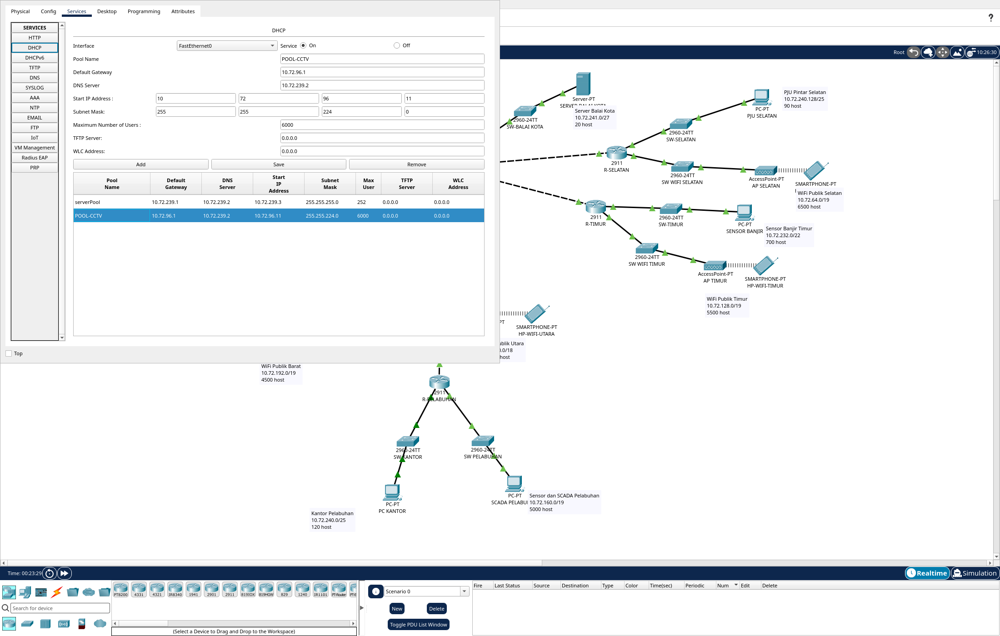
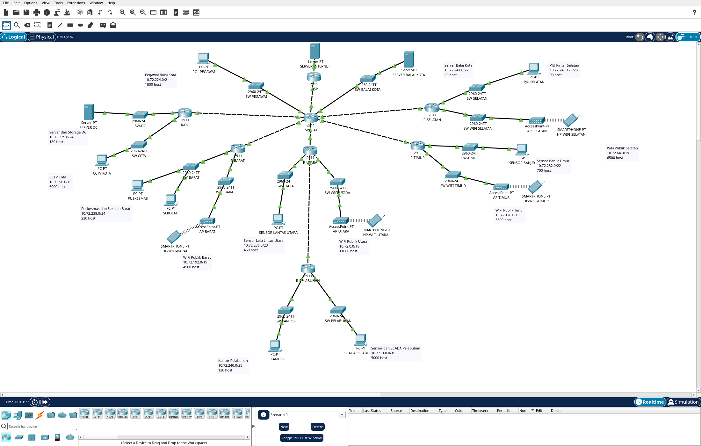
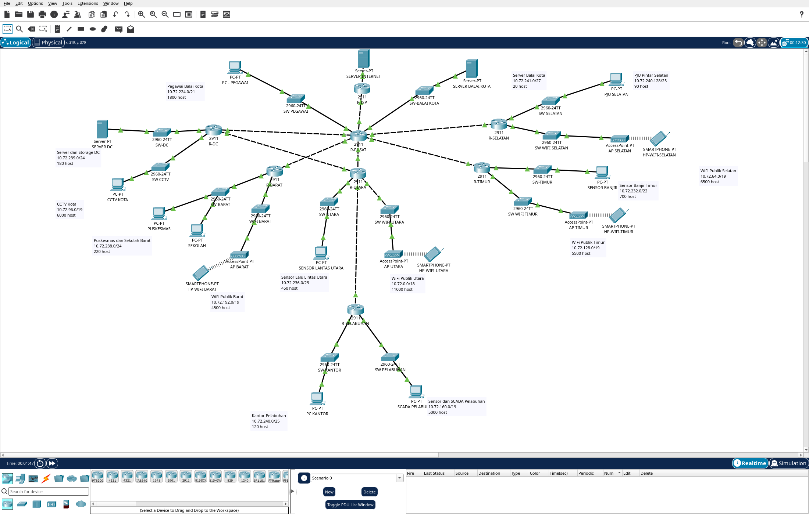
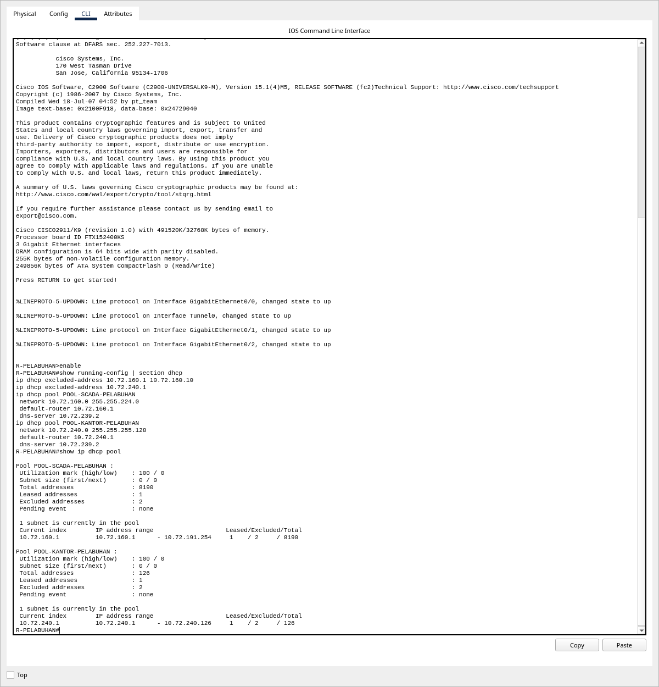
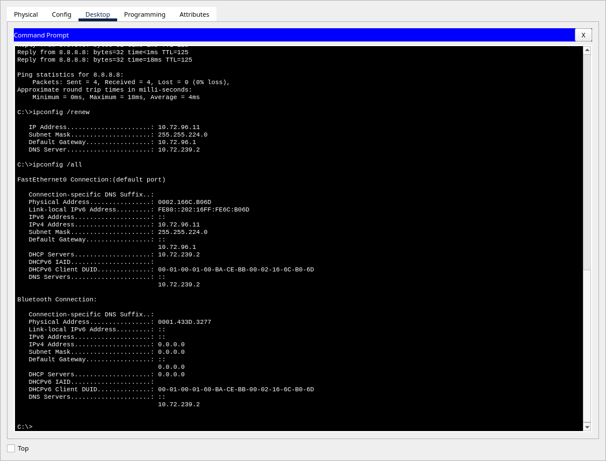

# Konfigurasi Packet Tracer: Kelompok 9, VLSM

Pemetaan berikut sesuai perangkat dalam `K9_VLSM.pkt` dan `K9_VLSM_OSPF.pkt`.
Sumber pengalamatan: `K9_Subnetting.xlsx`, sheet **VLSM** dan **IP Interface VLSM**.
Setiap file memiliki 45 perangkat: 8 router, 14 switch, 4 access point, 4 smartphone,
9 PC, 3 server, dan 3 perangkat distribusi daya. Ada 15 endpoint internal yang mewakili 14 LAN;
Puskesmas dan Sekolah berbagi satu LAN.
File static memiliki 37 kabel, sedangkan OSPF memiliki 38 kabel karena penambahan L7.

Bagian 1–3 membahas interface dan DHCP; bagian 4–5 membahas routing static dan NAT.
Konfigurasi GRE/IPsec serta OSPF ada di [laporan Anggota C](AnggotaC_GRE_OSPF_Layanan.md).

## 0. Pemetaan port final

| Router | Port | Fungsi | IP/prefix |
|---|---|---|---|
| R-PUSAT | Gi0/0 | R-ISP | 203.0.113.37/30 |
| R-PUSAT | Gi0/1 | L1 → R-DC | 10.72.241.33/30 |
| R-PUSAT | Gi0/2 | L2 → R-UTARA | 10.72.241.37/30 |
| R-PUSAT | Vlan10 (Fa0/0/0) | L3 → R-SELATAN | 10.72.241.41/30 |
| R-PUSAT | Vlan20 (Fa0/0/1) | L4 → R-TIMUR | 10.72.241.45/30 |
| R-PUSAT | Vlan30 (Fa0/0/2) | L5 → R-BARAT | 10.72.241.49/30 |
| R-PUSAT | Vlan40 (Fa0/0/3) | LAN Server Balai Kota | 10.72.241.1/27 |
| R-PUSAT | Vlan50 (Fa0/1/0) | LAN Pegawai Balai Kota | 10.72.224.1/21 |
| R-DC | Gi0/0 | L1 → R-PUSAT | 10.72.241.34/30 |
| R-DC | Gi0/1 | LAN Server dan Storage DC | 10.72.239.1/24 |
| R-DC | Gi0/2 | LAN CCTV Kota | 10.72.96.1/19 |
| R-UTARA | Gi0/0 | L2 → R-PUSAT | 10.72.241.38/30 |
| R-UTARA | Gi0/1 | L6 → R-PELABUHAN | 10.72.241.53/30 |
| R-UTARA | Gi0/2 | LAN Sensor Lalu Lintas Utara | 10.72.236.1/23 |
| R-UTARA | Vlan60 (Fa0/3/0) | LAN WiFi Publik Utara | 10.72.0.1/18 |
| R-PELABUHAN | Gi0/0 | L6 → R-UTARA | 10.72.241.54/30 |
| R-PELABUHAN | Gi0/1 | LAN Sensor dan SCADA Pelabuhan | 10.72.160.1/19 |
| R-PELABUHAN | Gi0/2 | LAN Kantor Pelabuhan | 10.72.240.1/25 |
| R-SELATAN | Gi0/0 | L3 → R-PUSAT | 10.72.241.42/30 |
| R-SELATAN | Gi0/1 | LAN PJU Pintar Selatan | 10.72.240.129/25 |
| R-SELATAN | Gi0/2 | LAN WiFi Publik Selatan | 10.72.64.1/19 |
| R-TIMUR | Gi0/0 | L4 → R-PUSAT | 10.72.241.46/30 |
| R-TIMUR | Gi0/1 | LAN Sensor Banjir Timur | 10.72.232.1/22 |
| R-TIMUR | Gi0/2 | LAN WiFi Publik Timur | 10.72.128.1/19 |
| R-BARAT | Gi0/0 | L5 → R-PUSAT | 10.72.241.50/30 |
| R-BARAT | Gi0/1 | LAN Puskesmas dan Sekolah Barat | 10.72.238.1/24 |
| R-BARAT | Gi0/2 | LAN WiFi Publik Barat | 10.72.192.1/19 |
| R-ISP | Gi0/0 | R-PUSAT | 203.0.113.38/30 |
| R-ISP | Gi0/1 | SERVER-INTERNET | 8.8.8.1/24 |
| R-DC, OSPF | Vlan1 (Fa0/0/0) | L7 → R-UTARA | 10.72.241.58/30 |
| R-UTARA, OSPF | Vlan1 (Fa0/3/1) | L7 → R-DC | 10.72.241.57/30 |

Port FastEthernet pada modul HWIC-4ESW adalah switchport access.
Alamat Layer 3 berada pada SVI `Vlan10`–`Vlan60` atau `Vlan1`, sesuai tabel.

| Server | Layanan | IP/prefix | Gateway |
|---|---|---|---|
| SERVER DC | DNS, FTP, Email, DHCP CCTV | 10.72.239.2/24 | 10.72.239.1 |
| SERVER BALAI KOTA | Web | 10.72.241.2/27 | 10.72.241.1 |
| SERVER-INTERNET | Target uji internet | 8.8.8.8/24 | 8.8.8.1 |

## 1. IP interface (Anggota B)

Blok berikut memakai interface dan VLAN yang telah tersedia dalam file final.

### R-PUSAT
```
configure terminal
interface GigabitEthernet0/1
 ip address 10.72.241.33 255.255.255.252
interface GigabitEthernet0/2
 ip address 10.72.241.37 255.255.255.252
interface Vlan10
 ip address 10.72.241.41 255.255.255.252
interface Vlan20
 ip address 10.72.241.45 255.255.255.252
interface Vlan30
 ip address 10.72.241.49 255.255.255.252
interface Vlan40
 ip address 10.72.241.1 255.255.255.224
interface Vlan50
 ip address 10.72.224.1 255.255.248.0
end
```

### R-DC
```
configure terminal
interface GigabitEthernet0/0
 ip address 10.72.241.34 255.255.255.252
interface GigabitEthernet0/1
 ip address 10.72.239.1 255.255.255.0
interface GigabitEthernet0/2
 ip address 10.72.96.1 255.255.224.0
 ip helper-address 10.72.239.2
end
```

### R-UTARA
```
configure terminal
interface GigabitEthernet0/0
 ip address 10.72.241.38 255.255.255.252
interface GigabitEthernet0/1
 ip address 10.72.241.53 255.255.255.252
interface GigabitEthernet0/2
 ip address 10.72.236.1 255.255.254.0
interface Vlan60
 ip address 10.72.0.1 255.255.192.0
end
```

### R-PELABUHAN
```
configure terminal
interface GigabitEthernet0/0
 ip address 10.72.241.54 255.255.255.252
interface GigabitEthernet0/1
 ip address 10.72.160.1 255.255.224.0
interface GigabitEthernet0/2
 ip address 10.72.240.1 255.255.255.128
end
```

### R-SELATAN
```
configure terminal
interface GigabitEthernet0/0
 ip address 10.72.241.42 255.255.255.252
interface GigabitEthernet0/1
 ip address 10.72.240.129 255.255.255.128
interface GigabitEthernet0/2
 ip address 10.72.64.1 255.255.224.0
end
```

### R-TIMUR
```
configure terminal
interface GigabitEthernet0/0
 ip address 10.72.241.46 255.255.255.252
interface GigabitEthernet0/1
 ip address 10.72.232.1 255.255.252.0
interface GigabitEthernet0/2
 ip address 10.72.128.1 255.255.224.0
end
```

### R-BARAT
```
configure terminal
interface GigabitEthernet0/0
 ip address 10.72.241.50 255.255.255.252
interface GigabitEthernet0/1
 ip address 10.72.238.1 255.255.255.0
interface GigabitEthernet0/2
 ip address 10.72.192.1 255.255.224.0
end
```

## 2. DHCP (Anggota B)

Pool router mengecualikan sepuluh alamat pertama pada LAN pengguna, kecuali Kantor Pelabuhan.
Kantor Pelabuhan mengecualikan hanya gateway `.1`: tersedia 125 lease untuk kebutuhan 120 klien.
Seluruh pool memberikan DNS `10.72.239.2`.

### R-PUSAT
```
configure terminal
ip dhcp excluded-address 10.72.224.1 10.72.224.10
ip dhcp pool POOL-PEGAWAI
 network 10.72.224.0 255.255.248.0
 default-router 10.72.224.1
 dns-server 10.72.239.2
end
```
LAN Server Balai Kota hanya berisi server dengan IP statis, jadi tidak perlu pool.

### R-UTARA
```
configure terminal
ip dhcp excluded-address 10.72.236.1 10.72.236.10
ip dhcp excluded-address 10.72.0.1 10.72.0.10
ip dhcp pool POOL-LALIN-UTARA
 network 10.72.236.0 255.255.254.0
 default-router 10.72.236.1
 dns-server 10.72.239.2
ip dhcp pool POOL-WIFI-UTARA
 network 10.72.0.0 255.255.192.0
 default-router 10.72.0.1
 dns-server 10.72.239.2
end
```

### R-PELABUHAN
```
configure terminal
ip dhcp excluded-address 10.72.160.1 10.72.160.10
ip dhcp excluded-address 10.72.240.1
ip dhcp pool POOL-SCADA-PELABUHAN
 network 10.72.160.0 255.255.224.0
 default-router 10.72.160.1
 dns-server 10.72.239.2
ip dhcp pool POOL-KANTOR-PELABUHAN
 network 10.72.240.0 255.255.255.128
 default-router 10.72.240.1
 dns-server 10.72.239.2
end
```

### R-SELATAN
```
configure terminal
ip dhcp excluded-address 10.72.240.129 10.72.240.138
ip dhcp excluded-address 10.72.64.1 10.72.64.10
ip dhcp pool POOL-PJU-SELATAN
 network 10.72.240.128 255.255.255.128
 default-router 10.72.240.129
 dns-server 10.72.239.2
ip dhcp pool POOL-WIFI-SELATAN
 network 10.72.64.0 255.255.224.0
 default-router 10.72.64.1
 dns-server 10.72.239.2
end
```

### R-TIMUR
```
configure terminal
ip dhcp excluded-address 10.72.232.1 10.72.232.10
ip dhcp excluded-address 10.72.128.1 10.72.128.10
ip dhcp pool POOL-BANJIR-TIMUR
 network 10.72.232.0 255.255.252.0
 default-router 10.72.232.1
 dns-server 10.72.239.2
ip dhcp pool POOL-WIFI-TIMUR
 network 10.72.128.0 255.255.224.0
 default-router 10.72.128.1
 dns-server 10.72.239.2
end
```

### R-BARAT
```
configure terminal
ip dhcp excluded-address 10.72.238.1 10.72.238.10
ip dhcp excluded-address 10.72.192.1 10.72.192.10
ip dhcp pool POOL-PUSKESMAS-BARAT
 network 10.72.238.0 255.255.255.0
 default-router 10.72.238.1
 dns-server 10.72.239.2
ip dhcp pool POOL-WIFI-BARAT
 network 10.72.192.0 255.255.224.0
 default-router 10.72.192.1
 dns-server 10.72.239.2
end
```

### DHCP CCTV Kota di SERVER DC (GUI: Services → DHCP)
- `serverPool` melayani LAN DC: gateway `10.72.239.1`, DNS `10.72.239.2`,
  start `10.72.239.3`, mask `255.255.255.0`, max users `252`.
  Gateway `.1` dan SERVER DC `.2` berada di luar rentang lease.
- Pool CCTV:
  - Nama `POOL-CCTV`
  - Default Gateway `10.72.96.1`
  - DNS `10.72.239.2`
  - Start IP `10.72.96.11`
  - Subnet Mask `255.255.224.0`
  - Max users `6000` (akhir rentang `10.72.119.122`, masih dalam `/19`)
- Pilih pool, klik **Save**, lalu pastikan service **On**.
- R-DC Gi0/2 sudah diberi `ip helper-address 10.72.239.2` di langkah 1.
- R-DC tidak memiliki DHCP pool router untuk CCTV.



### Klien WiFi

| Access point | SSID | Klien perwakilan |
|---|---|---|
| AP-UTARA | K9-WIFI-UTARA | HP-WIFI-UTARA |
| AP SELATAN | K9-WIFI-SELATAN | HP-WIFI-SELATAN |
| AP TIMUR | K9-WIFI-TIMUR | HP-WIFI-TIMUR |
| AP BARAT | K9-WIFI-BARAT | HP-WIFI-BARAT |

Keempat smartphone memakai Wireless0 dan DHCP dari router wilayah masing-masing.

## 3. IP statis server (Anggota B)

Di setiap server buka Desktop → IP Configuration → Static, lalu isi sesuai tabel di bagian 0:
- SERVER DC: `10.72.239.2`, `255.255.255.0`, gateway `10.72.239.1`, DNS `10.72.239.2`
- SERVER BALAI KOTA: `10.72.241.2`, `255.255.255.224`, gateway `10.72.241.1`, DNS `10.72.239.2`
- SERVER-INTERNET: `8.8.8.8`, `255.255.255.0`, gateway `8.8.8.1`

## 4. Static Route (Anggota A, Soal 3)

### R-PUSAT
```
configure terminal
ip route 0.0.0.0 0.0.0.0 203.0.113.38
ip route 10.72.96.0 255.255.224.0 10.72.241.34
ip route 10.72.239.0 255.255.255.0 10.72.241.34
ip route 10.72.0.0 255.255.192.0 10.72.241.38
ip route 10.72.236.0 255.255.254.0 10.72.241.38
ip route 10.72.160.0 255.255.224.0 192.168.9.2
ip route 10.72.240.0 255.255.255.128 192.168.9.2
ip route 10.72.241.52 255.255.255.252 10.72.241.38
ip route 10.72.241.54 255.255.255.255 10.72.241.38
ip route 10.72.64.0 255.255.224.0 10.72.241.42
ip route 10.72.240.128 255.255.255.128 10.72.241.42
ip route 10.72.128.0 255.255.224.0 10.72.241.46
ip route 10.72.232.0 255.255.252.0 10.72.241.46
ip route 10.72.192.0 255.255.224.0 10.72.241.50
ip route 10.72.238.0 255.255.255.0 10.72.241.50
end
```

### R-UTARA
```
configure terminal
ip route 0.0.0.0 0.0.0.0 10.72.241.37
ip route 10.72.160.0 255.255.224.0 10.72.241.54
ip route 10.72.240.0 255.255.255.128 10.72.241.54
end
```

### Router cabang (default route ke atas)
```
! R-DC
configure terminal
ip route 0.0.0.0 0.0.0.0 10.72.241.33
end

! R-SELATAN
configure terminal
ip route 0.0.0.0 0.0.0.0 10.72.241.41
end

! R-TIMUR
configure terminal
ip route 0.0.0.0 0.0.0.0 10.72.241.45
end

! R-BARAT
configure terminal
ip route 0.0.0.0 0.0.0.0 10.72.241.49
end

! R-PELABUHAN
configure terminal
ip route 0.0.0.0 0.0.0.0 10.72.241.53
ip route 10.72.241.37 255.255.255.255 10.72.241.53
ip route 10.72.224.0 255.255.248.0 192.168.9.1
ip route 10.72.241.0 255.255.255.224 192.168.9.1
end
```

Rute `/32` endpoint GRE tetap melewati jaringan fisik.
Rute dua LAN di masing-masing ujung tunnel memakai next-hop GRE.
Konfigurasi Tunnel0 harus aktif sebelum menguji rute tersebut.
R-ISP hanya memiliki dua jaringan connected, tanpa static route maupun OSPF.

## 5. NAT Overload (Anggota A, Soal 5) di R-PUSAT
```
configure terminal
access-list 1 permit 10.72.0.0 0.0.255.255
interface GigabitEthernet0/0
 ip nat outside
interface GigabitEthernet0/1
 ip nat inside
interface GigabitEthernet0/2
 ip nat inside
interface Vlan10
 ip nat inside
interface Vlan20
 ip nat inside
interface Vlan30
 ip nat inside
interface Vlan40
 ip nat inside
interface Vlan50
 ip nat inside
exit
ip nat inside source list 1 interface GigabitEthernet0/0 overload
end
```

## 6. Verifikasi, lalu simpan

Di setiap router dan switch jalankan `write memory`, kemudian simpan file Packet Tracer.
Untuk static/IPsec, periksa konfigurasi crypto sebelum menyimpan ulang setelah power-cycle;
lihat prosedur pemulihan di [laporan Anggota C](AnggotaC_GRE_OSPF_Layanan.md).

1. `show ip interface brief`: interface Layer 3 yang digunakan harus up/up; IP mengikuti tabel dan subnet GRE.
2. Di setiap PC: Desktop → IP Configuration → DHCP (atau `ipconfig /renew`). Harus dapat IP 10.72.x.x, gateway, dan DNS `10.72.239.2`.
3. `show ip route` di R-PUSAT static: 12 route LAN, route L6 `/30`, route endpoint `/32`, dan default ISP.
4. `show ip route` di R-ISP: hanya 203.0.113.36/30 dan 8.8.8.0/24.
5. Ping antar-wilayah, misalnya PC KANTOR → CCTV KOTA dan SEKOLAH → SERVER DC.
6. `ping 8.8.8.8` dari 1 host tiap wilayah, lalu `show ip nat translations` di R-PUSAT.
7. Simpan sesuai skenario: **`K9_VLSM.pkt`** untuk static atau **`K9_VLSM_OSPF.pkt`** untuk OSPF.

## 7. Topologi dan penyimpanan

- Setiap LAN memakai switch lokal agar batas subnet terlihat jelas. Empat LAN WiFi memakai access point
  dan smartphone perwakilan; LAN kabel memakai PC/server. Jumlah perangkat perwakilan tidak mengubah kebutuhan host.
- Router 2911 menyediakan port routed untuk backbone/LAN. HWIC-4ESW dan SVI menambah port di PUSAT,
  UTARA, serta DC pada file OSPF. Kabel Ethernet menghubungkan perangkat lokal dan router;
  koneksi wireless hanya digunakan pada empat LAN WiFi.
- Ke-14 LAN memiliki label nama subnet, Network ID/prefix, dan jumlah host.
- Seluruh switch memiliki hostname sesuai lokasi; spasi display name diganti tanda hubung pada hostname IOS.
- Kabel L5 berada pada R-PUSAT Fa0/0/2. Deskripsi lama yang salah pada Fa0/2/0 telah dihapus.
- R-DC OSPF memakai HWIC-4ESW untuk L7; alamat berada di Vlan1.
- L1–L6 dipertahankan. L7 hanya menambah jalur alternatif pada segitiga PUSAT–DC–UTARA.
- File OSPF memakai dua GRE tanpa IPsec. Bonus IPsec berada pada file static.
- Rangkuman pengujian native dan indeks screenshot tersedia di [README](README.md).








