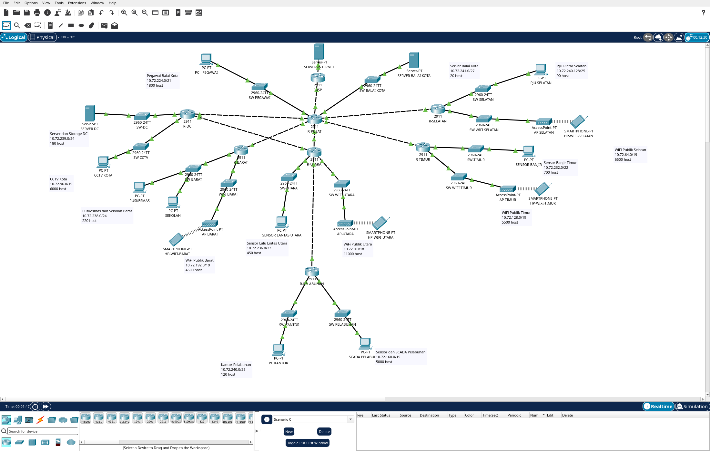

# Mid Project Jarkom: Smart City Surabaya, Kelompok 9

Implementasi memakai **VLSM `10.72.0.0/16`**, domain `k9.smartcity.lab`.
Dua file Packet Tracer telah diuji pada **Cisco Packet Tracer 9.0.1.0858**.
Arsip pengumpulan: `MidProject Jarkom_K9_044_060_079.ZIP`.

## Berkas pengumpulan

| Berkas | Isi |
|---|---|
| [K9_VLSM.pkt](K9_VLSM.pkt) | Static routing, NAT, DHCP, GRE Tunnel0 + IPsec, DNS, Web, FTP, Email |
| [K9_VLSM_OSPF.pkt](K9_VLSM_OSPF.pkt) | OSPF, L7, dua GRE tanpa IPsec, NAT, DHCP, dan layanan aplikasi |
| [K9_Subnetting.xlsx](K9_Subnetting.xlsx) | Kebutuhan host, VLSM, CIDR, supernet, revisi UTS, IP interface |
| [AnggotaA_Routing_NAT.md](AnggotaA_Routing_NAT.md) | Soal 2, 3, 5: perhitungan subnet, static routing, NAT, bukti uji |
| [K9_PT_Config.md](K9_PT_Config.md) | Soal 1, 4: perangkat, port, pengalamatan, DHCP, topologi |
| [AnggotaC_GRE_OSPF_Layanan.md](AnggotaC_GRE_OSPF_Layanan.md) | Soal 6, 7, 8: GRE/IPsec, OSPF, failover, aplikasi, pemulihan |
| [screenshots/](screenshots/) | Bukti visual native Packet Tracer dan tabel workbook |
| [evidence/](evidence/README.md) | Log runtime, retry, failover, dan pemulihan IPsec |
| [portal/index.html](portal/index.html) | Sumber halaman Portal Smart City Surabaya |
| [samples/rekaman-cctv-k9.txt](samples/rekaman-cctv-k9.txt) | Payload uji upload FTP, 272 byte |
| [scripts/validate_artifacts.py](scripts/validate_artifacts.py) | Pemeriksaan workbook dan konfigurasi tersimpan |
| [tests/test_artifact_validator.py](tests/test_artifact_validator.py) | Delapan pengujian validator dan regresi |

Soal tersedia di [Mid Project Jarkom.md](Mid%20Project%20Jarkom.md),
foto perhitungan awal di [UTS Tulis/](UTS%20Tulis/).

## Topologi dan pengalamatan

Setiap file berisi **45 perangkat**: 8 router, 14 switch, 4 access point, 4 smartphone,
9 PC, 3 server, dan 3 perangkat distribusi daya.
Ada 15 endpoint internal yang mewakili 14 LAN; Puskesmas dan Sekolah berbagi satu LAN.
Empat LAN WiFi mempunyai smartphone DHCP perwakilan. Semua LAN diberi label subnet dan kebutuhan host.
File static memiliki 37 kabel; file OSPF memiliki 38 kabel karena tambahan L7.



[Topologi static](screenshots/static-topology.png) dan [pemetaan port lengkap](K9_PT_Config.md).

| Kebutuhan | Alamat |
|---|---|
| Link R-PUSAT ke R-ISP | `203.0.113.36/30`, PUSAT `.37`, ISP `.38` |
| Server internet | `8.8.8.8/24`, gateway `8.8.8.1` |
| GRE Tunnel0 | `192.168.9.0/30`, PUSAT `.1`, PELABUHAN `.2` |
| GRE Tunnel1, hanya OSPF | `192.168.9.4/30`, PUSAT `.5`, PELABUHAN `.6` |
| L7, hanya OSPF | `10.72.241.56/30`, UTARA `.57`, DC `.58` |
| DNS, FTP, Email, DHCP CCTV | SERVER DC `10.72.239.2/24`, gateway `10.72.239.1` |
| Web | SERVER BALAI KOTA `10.72.241.2/27`, gateway `10.72.241.1` |

Workbook memuat 20 alokasi VLSM, 20 alokasi CIDR, 12 simpul supernet, dan 12 revisi UTS.
VLSM membutuhkan 61.752 alamat untuk 42.092 host yang diminta, sebelum L7.
Pohon CIDR pembanding memakai `10.72.0.0/14`; implementasi mengikuti sheet VLSM.

| Pool DHCP | Rentang lease | Kapasitas |
|---|---|---|
| CCTV pada SERVER DC | `10.72.96.11` sampai `10.72.119.122` | 6.000 |
| Kantor Pelabuhan pada router | `10.72.240.2` sampai `10.72.240.126` | 125, memenuhi kebutuhan 120 |
| LAN Server DC pada SERVER DC | `10.72.239.3` sampai `10.72.239.254` | 252 |

CCTV memakai DHCP server DC melalui `ip helper-address`; seluruh pool memberi DNS `10.72.239.2`.
Kapasitas dihitung dari subnet, exclusions, dan batas pool. Uji runtime menggunakan klien perwakilan,
bukan 6.000 atau 120 perangkat serentak.

## Hasil verifikasi

| Pemeriksaan | Static | OSPF |
|---|---|---|
| Ping semua pasangan 15 endpoint internal | 210/210 arah mencapai 4/4 | 210/210 arah mencapai 4/4 |
| Ping internet `8.8.8.8` melalui NAT | 15/15 endpoint mencapai 4/4 | 15/15 endpoint mencapai 4/4 |
| DNS `www`, `ftp`, `mail` | 45/45 lookup benar | 45/45 lookup benar |
| HTTP portal | 15/15 body cocok dengan sumber | 15/15 body cocok dengan sumber |
| Renew DHCP CCTV, Kantor, WiFi Utara | IP, mask, gateway, DNS sesuai | IP, mask, gateway, DNS sesuai |
| FTP login dan upload CCTV | 272 byte terkirim | 272 byte terkirim |
| Email Pusat ↔ Pelabuhan | Kedua penerima menerima pesan | Kedua penerima menerima pesan |
| GRE dua arah | Hop `.2` / `.1` pada Tunnel0 | Tunnel0 normal, Tunnel1 saat L2 gagal |
| IPsec | `QM_IDLE`, counter encrypt/decrypt bertambah | GRE tanpa IPsec |
| L1 putus secara terpisah | Topologi static tidak memakai L7 | CCTV 4/4 melalui L2 + L7 |
| L2 putus secara terpisah | Topologi static tidak memakai L7 | GRE dan internet pulih melalui L1 + L7 |

Angka ping adalah hasil stabil setelah warm-up/retry. Log mentah tetap memuat timeout awal:
222 hasil ping mesh static dan 212 hasil ping mesh OSPF, masing-masing mencakup 210 arah sukses.
Hasil ini membuktikan konektivitas representatif, bukan pengukuran kapasitas atau jaminan tanpa packet loss saat konvergensi.

R-ISP hanya memiliki jaringan connected publik dan internet; tidak ada route balik privat.
NAT menggunakan IP publik R-PUSAT `203.0.113.37`.
Running/startup-config cocok pada 8 router dan 14 switch di setiap artefak final.
File final dibuka ulang tanpa modul scripting dan lolos ping GRE/internet serta traceroute GRE.

### Indeks bukti visual

| Pemeriksaan | Bukti |
|---|---|
| Subnetting | [VLSM](screenshots/subnetting-vlsm.png), [CIDR](screenshots/subnetting-cidr.png), [revisi](screenshots/subnetting-revisi.png) |
| Routing dan NAT | [Route PUSAT](screenshots/static-routes-pusat.png), [ISP](screenshots/static-routes-isp.png), [translasi NAT](screenshots/static-nat-translations.png) |
| DHCP | [Router](screenshots/static-dhcp-router.png), [server CCTV](screenshots/ospf-dhcp-server.png), [renew klien](screenshots/static-dhcp-client.png) |
| Internet tujuh wilayah | [Daftar per wilayah](AnggotaA_Routing_NAT.md#4-verifikasi-dan-screenshot) |
| GRE/IPsec static | [Trace](screenshots/static-gre-pusat.png), [SA](screenshots/static-ipsec.png), [pemulihan](screenshots/static-recovery-ipsec.png) |
| Layanan | [Web](screenshots/ospf-web-final.png), [FTP](screenshots/static-ftp-upload.png), [email Pusat](screenshots/ospf-email-pegawai-final.png), [email Pelabuhan](screenshots/ospf-email-kantor-final.png) |
| OSPF | [Neighbor](screenshots/ospf-neighbors-pusat.png), [route DC](screenshots/ospf-routes-dc.png) |
| Failover | [L1](screenshots/ospf-l1-failover.png), [route saat L1 down](screenshots/ospf-l1-routes.png), [L2/Tunnel1](screenshots/ospf-l2-trace-screen.png) |
| Pembukaan final static | [GRE](screenshots/static-final-gui-gre.png), [internet](screenshots/static-final-gui-internet.png), [trace](screenshots/static-final-gui-trace.png), [ISAKMP](screenshots/static-final-gui-isakmp.png) |
| Pembukaan final OSPF | [GRE](screenshots/ospf-final-gui-gre.png), [internet](screenshots/ospf-final-gui-internet.png), [trace](screenshots/ospf-final-gui-trace.png) |

## Membuka dan mengulang demo

1. Buka file sesuai skenario di Packet Tracer 9.0.1.0858, tunggu link serta routing siap.
2. Renew DHCP bila perlu. Contoh alamat teruji: PC - PEGAWAI `10.72.224.11`, PC KANTOR `10.72.240.2`,
   CCTV KOTA `10.72.96.11`. Gunakan `ipconfig` untuk memastikan alamat klien pada sesi baru.
3. Ulangi ping setelah ARP, DHCP, IKE, atau OSPF konvergen. Timeout awal terlihat pada bukti warm-up.
4. Pada file static, buktikan IPsec dengan `show crypto isakmp sa` dan `show crypto ipsec sa`.
   Setelah power-cycle perangkat, jalankan
   [prosedur pemulihan crypto](AnggotaC_GRE_OSPF_Layanan.md#15-pemulihan-ipsec-setelah-power-cycle-packet-tracer).
   Startup-copy saja tidak memulihkan crypto pada percobaan yang direkam.
5. Pada file OSPF, matikan L1 dan L2 satu per satu sesuai
   [prosedur failover](AnggotaC_GRE_OSPF_Layanan.md#35-uji-kegagalan-l1-dan-l2-secara-terpisah).
   Pulihkan link sebelum melanjutkan skenario atau menyimpan file.

L7 hanya memberi redundansi pada segitiga PUSAT, DC, dan UTARA.
L3, L4, L5, serta L6 tetap single-link; kegagalannya mengisolasi cabang terkait.
Tunnel1 dapat mulai pada `INIT`, lalu mencapai `FULL` saat failover L2.
Perpindahan kembali ke Tunnel0 tidak selalu langsung terjadi setelah pemulihan.

## Validasi artefak secara lokal

Gunakan Python 3.10+ dengan `pkt-core==0.2.2` tersedia pada environment.
Pada environment pengerjaan, interpreter berada di `.venv/bin/python`.

```sh
python -B scripts/validate_artifacts.py
python -B -m unittest discover -s tests -v
sha256sum -c evidence/artifact-sha256.txt
```

Validator membaca workbook dan kedua `.pkt` tanpa mengubahnya. Pemeriksaan mencakup subnet/range,
topologi, interface, startup-config, kapasitas DHCP, layanan, NAT/ISP, route static,
serta pemisahan OSPF fisik/GRE. Delapan test lulus, termasuk tujuh mutasi regresi terkontrol.
Jalankan tanpa `-O` karena validator menggunakan assertion.
Formula workbook diperiksa melalui cached values; hitung ulang di aplikasi spreadsheet jika formula diubah.
Bukti runtime native terdapat pada [indeks evidence](evidence/README.md).
